# 系统架构设计文档（System Architecture Design）

## 0. 文档信息

| 项目          | 内容                                                         |
| ------------- | ------------------------------------------------------------ |
| 项目名称      | 小家账本（family-ledger）                                    |
| 文档版本/状态 | v1.0 / Approved                                              |
| 架构负责人    | 项目所有者（个人项目）                                       |
| 更新日期      | 2026-10-12                                                   |
| 上游需求      | [PRD](./01-PRD.md)                                           |
| 下游契约      | [Data Model](./04-DATA-MODEL.md) · [API Specification](./05-API-SPECIFICATION.md) |

> 本文不含账户 ID、域名、邮箱等环境信息，这些只记在私人目录 `config/private/`。逐项架构决策见 `docs/adr/`，访问模式与事务细节见 `docs/storage-design.md`，部署与恢复步骤见 `docs/部署.md` 与 `docs/运维Runbook.md`。

## 1. 架构目标、范围与约束

### 1.1 目标与设计原则

- **AI 输出只是候选**：结构由严格 Schema 校验，业务入账必须由发起人确认（BR-009）。
- **幂等与可恢复**：所有写操作带动作 ID，重试命中原结果；外部副作用经 outbox 投递，入账状态与投递状态分开（NFR-003）。
- **最小权限**：按入口拆分函数，每个函数只拿到所需权限；系统管理员默认无权读家庭账目（NFR-002）。
- **无服务器、按量付费**：新增费用目标不超过 NZD 15／月（NFR-007），实际约 USD 1.5–2.5。
- **金额不经浮点**：后端以最小货币单位整数计算；前端只做字符串或整数运算（NFR-008）。
- **离线可验证**：本地用 DynamoDB Local 与替身服务复现完整业务，证据层级（静态、离线、真实、部署）分开标注。

### 1.2 架构范围

- **包含**：网站前端、HTTP API、六个入口函数、数据存储、识别链路、飞书接入、汇率与账单同步、告警、部署与运维脚本。
- **不包含**：银行同步、真实支付、账户余额、多区域容灾、移动原生应用。

### 1.3 假设与关键容量预估

| 指标            | 预估                                                         | 来源/假设                                                |
| --------------- | ------------------------------------------------------------ | -------------------------------------------------------- |
| 用户数/并发数   | 约 2 个账号，并发极低                                        | PRD 3.4：少数私人用户                                    |
| 日请求量        | 数十至数百次，主要来自页面加载与手工记账                     | 家庭记账的推算；预热请求另计                             |
| 数据总量/年增长 | 每年约数百条账目与数十张照片                                 | 推算：已导入的三个月历史约 130 条；真实用量未知（PRD Q-003） |
| 峰值任务        | 一次 AI 输入最多 10 条候选；批量确认一个事务不超过 100 个写项 | PRD 业务规则与 DynamoDB 事务上限                         |

> 容量只用于估算成本与选型，不作为强制用户配额。

## 2. 系统上下文（Context）

### 2.1 参与者与外部依赖

| 对象               | 类型     | 交互目的                         | 数据类型                       | 故障影响                                           |
| ------------------ | -------- | -------------------------------- | ------------------------------ | -------------------------------------------------- |
| 浏览器（桌面/手机）| 内部入口 | 全部功能                         | 账目、照片、会话令牌           | 无法使用网站                                       |
| 飞书客户端与平台   | 第三方   | 私聊记账、卡片确认、告警通知     | 用户私聊文字、图片、卡片       | 飞书入口不可用；网站不受影响                       |
| 大模型服务         | 云服务   | 把文字或小票识别为候选           | 选定文字与图片（不含用户标识） | AI 识别失败，提示手工录入；手工记账不受影响        |
| 汇率服务（ECB）    | 第三方   | 每日同步汇率                     | 日期与币种                     | 新日期无汇率，回看最多 7 天，其余仍可记账          |
| 账单查询服务       | 云服务   | 每日同步云账单                   | 费用汇总                       | 费用页显示旧数据，应用估算仍可用                   |
| 身份服务           | 云服务   | 登录、令牌、账号管理             | 登录凭证                       | 无法登录                                           |
| DNS 与 CDN         | 云服务   | 域名解析与 HTTPS 分发            | 页面与接口流量                 | 站点不可达                                         |

### 2.2 系统上下文图

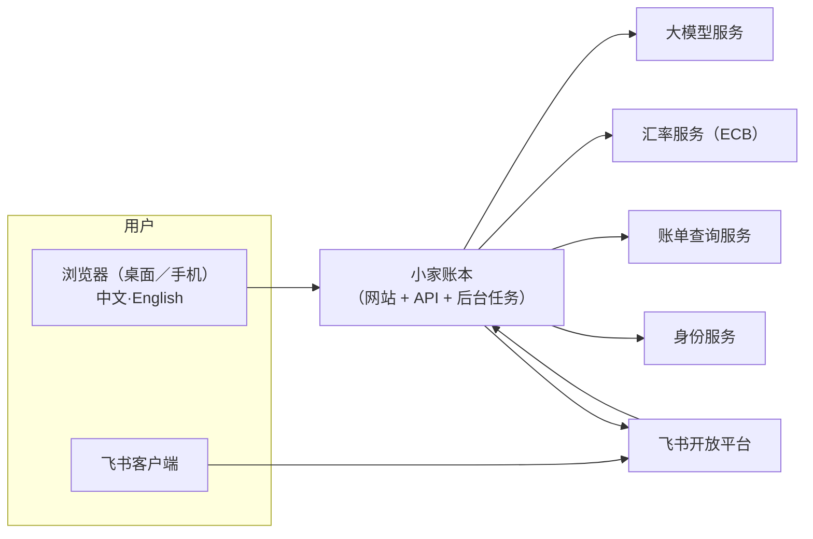

## 3. 总体架构（High-Level Architecture）

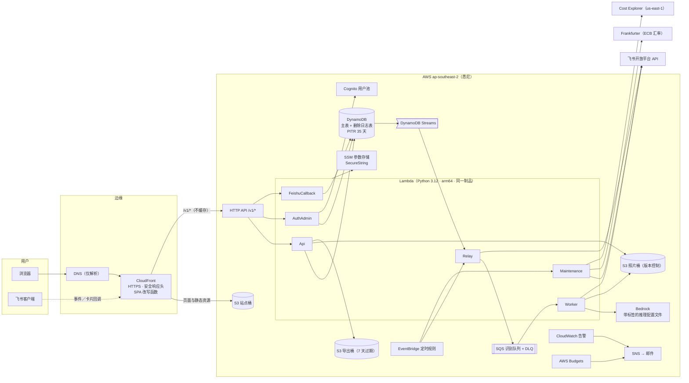

要点：

1. **同源访问**：网站与 API 共用一个域名，CloudFront 按路径分流（`/v1/*` 到 HTTP API，其余到 S3）。刷新令牌的 cookie 可用 `SameSite=Strict`，无需 CORS（ADR-0014）。
2. **一个制品、多个入口**：六个 Lambda 共用同一个 zip，通过不同入口函数与 IAM 权限区分职责。
3. **异步链路**：识别任务与飞书消息先在同一事务里写入任务与 outbox，再由 Streams 触发 Relay 派发，避免“请求成功但消息丢失”。
4. **外部数据只经 Maintenance 拉取**：汇率与账单各每日一次，结果写入 DynamoDB，接口只读本地数据。

### 3.1 组件职责与边界

| 组件 ID | 组件                       | 职责                                                                                             | 输入/输出                                  | 不承担的职责                               |
| ------- | -------------------------- | ------------------------------------------------------------------------------------------------ | ------------------------------------------ | ------------------------------------------ |
| CMP-001 | 前端（React 单页应用）     | 界面、表单与折算预览、i18n、主题、API 客户端、令牌仅存内存                                       | 用户操作 / 对 `/v1/*` 的请求               | 业务规则的最终裁决、金额的浮点运算         |
| CMP-002 | CloudFront 与站点桶        | HTTPS、静态资源、SPA 路由改写、`/v1/*` 转发、安全响应头                                          | 浏览器请求 / 静态文件或转发                | 缓存 API 响应                              |
| CMP-003 | HTTP API                   | 路径分流到三个同步入口函数                                                                       | 请求 / 请求                                | 业务逻辑                                   |
| CMP-004 | Api 函数                   | 账目、分类、汇率、家庭、照片、导出、AI 任务提交、月度总览                                        | HTTP / JSON                                | 持有身份服务管理权限、调用模型             |
| CMP-005 | AuthAdmin 函数             | 登录、刷新、改密、系统管理员建号与重置、费用页                                                   | HTTP / JSON                                | 家庭账目写入                               |
| CMP-006 | FeishuCallback 函数        | 飞书事件与卡片回调：验签解密、去重、卡片内编辑确认（3 秒内响应）                                 | 飞书回调 / 卡片 JSON                       | 在请求内调用模型或发消息                   |
| CMP-007 | Relay 函数                 | 把待派发的识别任务送入队列；投递到期的飞书消息                                                   | Streams 记录、定时 / 队列消息、飞书消息    | 识别、账目写入                             |
| CMP-008 | Worker 函数                | 调用模型识别、严格解析、生成候选批次、下载飞书图片                                               | 队列消息 / 候选批次                        | 写入正式账目                               |
| CMP-009 | Maintenance 函数           | 回收站与孤儿照片清理、候选过期、汇率同步、账单同步、预算检查、投递兜底                           | 定时事件 / 数据与告警                      | 响应用户请求                               |
| CMP-010 | DynamoDB（主表与删除日志） | 全部业务权威状态；删除日志防止从备份复活                                                         | 事务与查询 / 数据                          | 存放照片与导出文件                         |
| CMP-011 | 对象存储（照片、导出、站点）| 私有存放小票照片、导出文件与前端静态文件                                                         | 预签名上传与下载 / 对象                    | 作为业务状态的权威来源                     |
| CMP-012 | 身份服务（Cognito）        | 账号凭证、令牌签发与撤销                                                                         | 登录与管理调用 / 令牌                      | 家庭关系、角色（由应用保存）               |
| CMP-013 | 识别队列                   | 解耦提交与识别，失败重投三次后进死信队列                                                         | 任务引用 / 任务引用                        | 保存任务正文                               |
| CMP-014 | 密钥与配置（SSM）          | 会话签名密钥与飞书凭证，只接受加密类型                                                           | 参数读取 / 密钥                            | 保存业务数据                               |
| CMP-015 | 监控与告警                 | 告警（死信、积压、5xx、Worker 错误）、预算通知                                                   | 指标 / 邮件                                | 自动停服                                   |

### 3.2 模块依赖关系

前端：

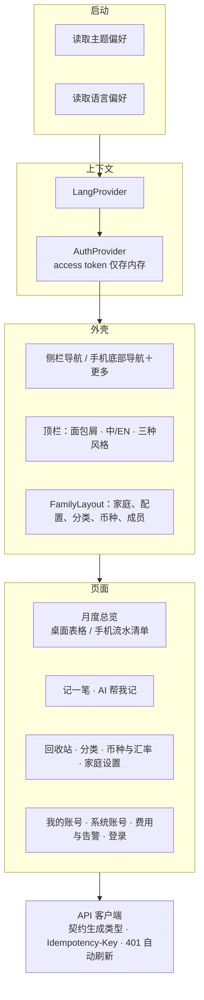

后端分层（依赖只能向下）：

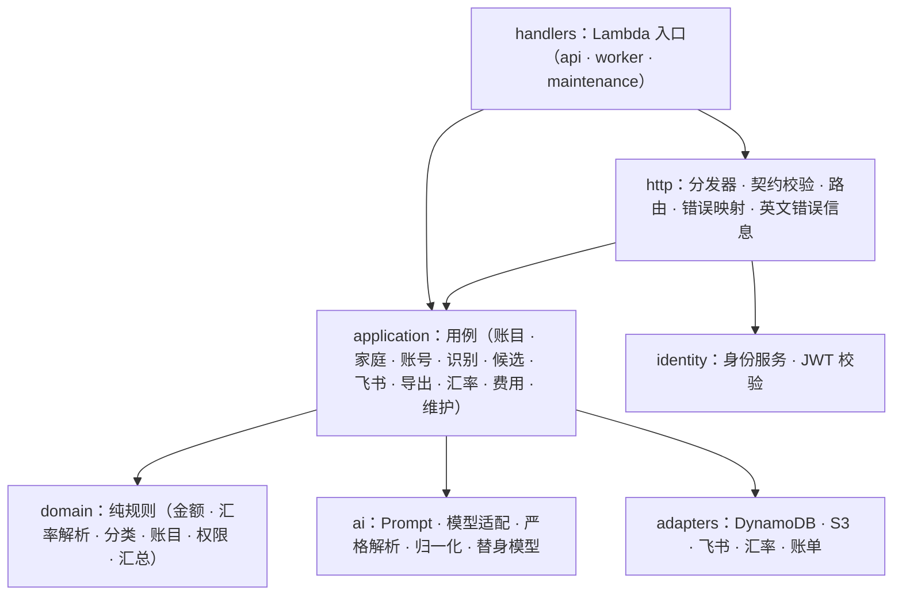

## 4. 技术栈与选型依据

| 层次    | 选型                                                         | 版本/约束                     | 原因                                                         | 替代方案/放弃原因                                         |
| ------- | ------------------------------------------------------------ | ----------------------------- | ------------------------------------------------------------ | --------------------------------------------------------- |
| 客户端  | React、Vite、TypeScript                                      | React 19，TypeScript 5.9      | 单页应用、类型由 OpenAPI 契约生成                            | 服务端渲染：无 SEO 需求，增加运维                         |
| 服务端  | Python（uv 管理）、Lambda、HTTP API                          | Python 3.12，arm64            | 按量付费，个人规模成本最低；领域规则用纯函数便于测试         | 容器常驻：闲置成本更高                                    |
| 存储    | DynamoDB 单表＋删除日志表；S3                                | 按需计费，PITR 35 天          | 访问模式固定，无服务器；事务满足一致性（ADR-0009）           | 关系数据库：需常驻实例与备份运维                          |
| 身份    | Cognito 用户池                                               | 关闭自助注册                  | 托管令牌与撤销；应用自己保存家庭与角色（ADR-0012）          | 自建认证：安全负担大                                      |
| 模型    | Bedrock（Nova Pro）经带标签的推理配置文件                    | 强制工具调用与约束解码        | 按真实评估同时比较效果与成本（ADR-0015）                     | 更大模型：成本高且样本上收益不足                          |
| 部署    | AWS CDK（TypeScript）                                        | CoreStack＋证书栈             | 基础设施即代码，可断言测试                                   | 手工控制台：不可复现                                      |
| 测试/CI | pytest、vitest、Playwright、CDK 断言、GitHub Actions         | 桌面与 iPhone 视口            | 契约、离线集成与浏览器旅程分层                               | 仅手工测试：回归不可控                                    |

## 5. 核心流程与时序（Runtime Flows）

### 5.1 关键用户操作

**请求路径与处理链**

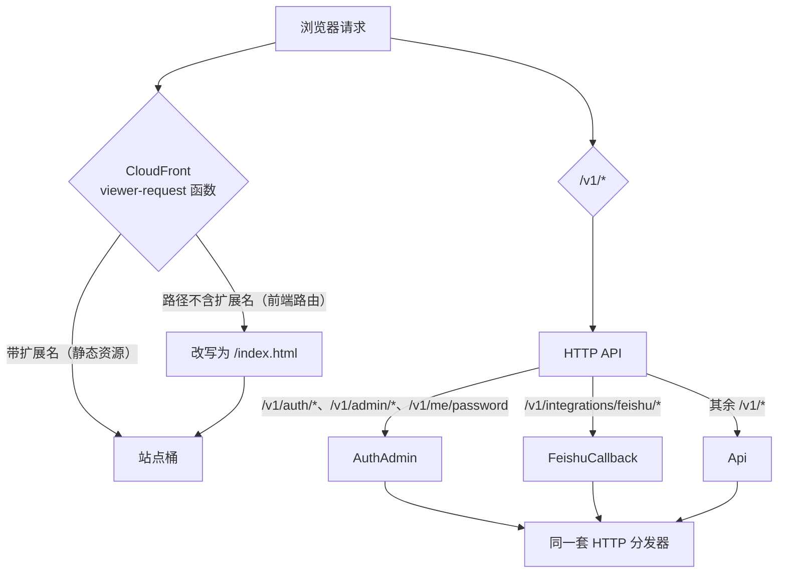

每个请求在后端经过相同的处理链：

1. **契约校验**：按 OpenAPI 契约（构建时转为 JSON）校验路径、参数与请求体。
2. **身份**：校验令牌签名、受众、过期与账号会话边界；写操作校验 CSRF（双提交 cookie 加来源白名单）。
3. **授权**：按家庭成员关系与角色判断（契约中的 `x-authz`），系统管理员不默认拥有家庭账目读取权。
4. **执行**：领域规则（金额精度、分类类型一致、退款上限、版本冲突）加 DynamoDB 事务。
5. **幂等**：动作回执与业务数据在同一事务写入，重复请求返回原结果。
6. **审计与日志**：记录操作类别与结果，不记录备注、金额等内容。
7. **错误信息语言**：请求头 `X-Ledger-Lang: en` 时，在响应出口把错误 `message` 换成英文，错误码不变。

**手工记账**

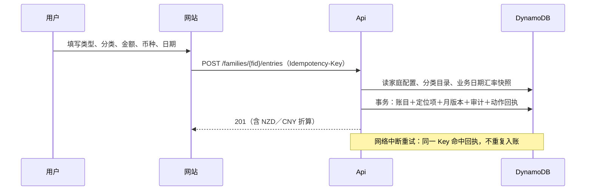

- 金额以最小货币单位整数存储，折算逐笔 ROUND_HALF_UP。
- 汇率以 USD 为基准，取业务日期起向前最多 7 天内的完整汇率组（ADR-0004）；家庭可补录、修正，只影响本家庭。
- 家庭时区决定“今天”：新记账默认日期、AI 的相对日期与总览默认月份。
- 删除进入回收站，30 天后由 Maintenance 彻底清除并写删除日志。

**月度总览的显示币种**

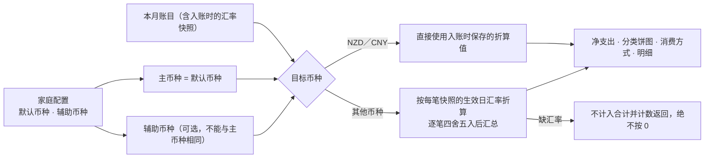

只影响显示，不改写账目，也不影响导出（导出仍为合 NZD、合 CNY）。

### 5.2 异步或后台任务

**网站 AI 识别**

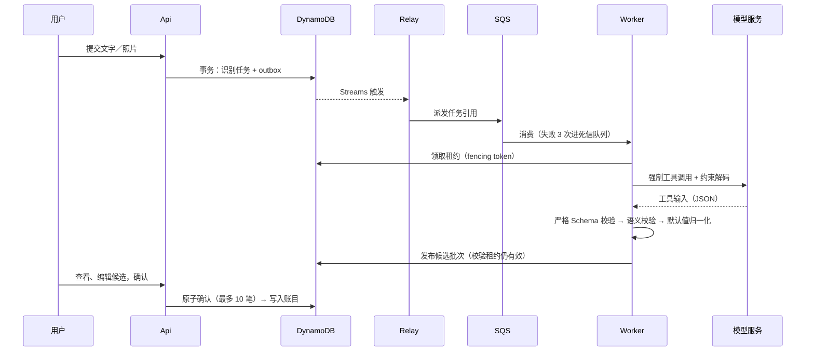

- 每个任务至多 2 次模型调用；限流时等待后重试；格式错误不付费重试，任务失败提示手工录入。
- 模型推断的币种与方式不采用，改用家庭默认值并标注“默认”（ADR-0015）。
- 候选 7 天未确认自动过期，不会进入账本。

**飞书私聊记账**

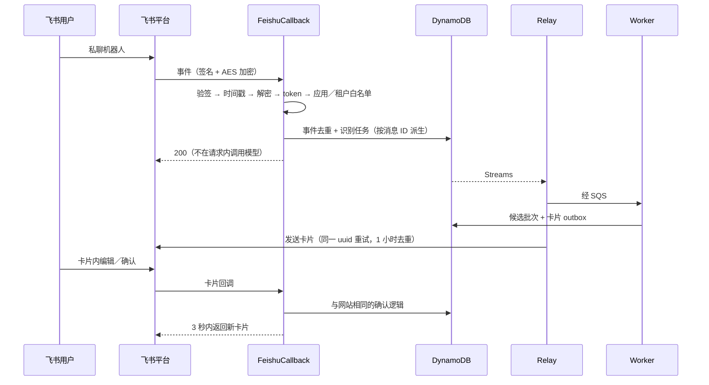

- 身份只取平台可信字段（`open_id` 加 `tenant_key`），经一次性绑定码映射到网站账号。
- 两个回调地址都按事件类型分派，后台填反也能正确处理。

**每日数据同步：汇率与账单**

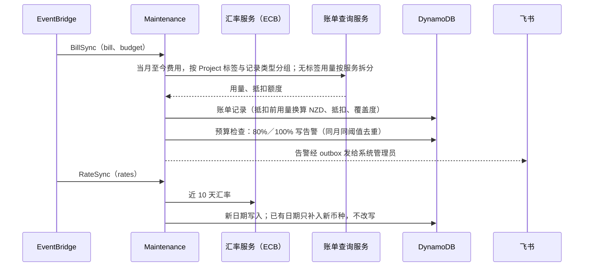

- 账户有抵扣额度时，账单金额与告警按抵扣前用量计算，页面另显示抵扣与实付。
- 无标签用量大于等于 USD 0.01 时才多发一次按服务拆分的请求；每月 1 日同步上月全月；账单数据约有 1 天延迟。

**照片与导出**

- 照片上传：Api 签发限定类型、大小与键的 S3 POST 表单，浏览器直传，Api 校验真实格式、像素、摘要后登记；查看用 60 秒有效的预签名链接。
- 导出：Api 按月份与筛选生成 Excel 或 CSV（防公式注入），写入导出桶，返回 5 分钟有效的下载链接；文件 7 天后自动删除。

### 5.3 定时任务

| 规则                          | 时间（UTC）            | 新西兰时间（夏令时） | 任务                                                        |
| ----------------------------- | ---------------------- | -------------------- | ----------------------------------------------------------- |
| ApiWarmup、AuthWarmup、FeishuWarmup | 18:00–10:55 每 5 分钟 | 7:00–23:55           | 预热（持有 0.3 秒以保持多实例）                             |
| OutboxSweep                   | 每 5 分钟              | —                    | Relay：派发遗漏的识别任务与飞书消息                         |
| DeliverySweep                 | 每 5 分钟              | —                    | Maintenance 投递兜底                                        |
| DailyMaintenance              | 每日 14:17             | 约 3:17              | 回收站清除、孤儿照片、批次过期、预算检查                    |
| BillSync                      | 每日 15:47             | 约 4:47              | 账单同步，随后预算检查                                      |
| RateSync                      | 每日 16:30             | 约 5:30              | 拉取近 10 天汇率，只新增不改写                              |

## 6. 数据架构

- DynamoDB 单表设计：账号、家庭、账目、任务、候选、回执等共用一张主表，按分区键前缀隔离；另有一张删除日志表。完整键、字段、访问模式与事务见 [数据模型](./04-DATA-MODEL.md)。
- 一致性：账目写入同时更新月版本，总览用它检测并发变化（ADR-0010）；修改都带 `expected_version`；外部副作用只经 outbox。
- 备份：PITR 35 天；照片桶开启版本控制，非当前版本 35 天过期；删除日志保证恢复环境重放删除。
- 留存：回收站 30 天，候选正文 7 天，孤立照片 7 天，审计 180 天，导出 7 天。

## 7. 集成与接口架构

- **对外接口**：全部 HTTP 接口以 `contracts/openapi.yaml` 为唯一事实来源（见 [API 规范](./05-API-SPECIFICATION.md)）；前端类型由它生成，后端按它做运行时校验，契约测试保证三者一致。
- **模型适配边界**：识别结果分层记录（请求返回、结构合法、语义合法、已发布），防止把“调用成功”当作“记账成功”（ADR-0011）。
- **飞书**：企业自建应用，只处理私聊；入口不同步调用模型或发消息，消息经 outbox 与 Relay 投递（ADR-0013）。
- **汇率与账单**：只经 Maintenance 拉取，接口读本地数据；向汇率服务只发送日期与币种。

## 8. 安全与隐私架构（Security & Privacy）

| 主题           | 设计/控制措施                                                                                                                         | 对应需求            |
| -------------- | ------------------------------------------------------------------------------------------------------------------------------------- | ------------------- |
| 身份认证       | 登录名由应用解析为固定用户 ID 再向身份服务认证；access token 15 分钟且只存浏览器内存；refresh token 30 天，放 HttpOnly、Strict 的 cookie，可撤销 | FR-001、BR-016      |
| 授权与隔离     | 按家庭成员关系判断，服务端强制；跨家庭访问一律 404；候选只能由发起人确认；每次提交事务内重新校验账号与成员版本                      | NFR-002、BR-011     |
| 传输与存储     | 全站 HTTPS（HSTS）；S3 与队列拒绝非 TLS；存储全部私有，照片与导出只经短时预签名链接                                                 | NFR-004             |
| 秘钥保护       | 会话密钥与飞书凭证在 SSM SecureString，代码只接受加密类型；私人参数放私有目录，不入库                                               | NFR-004             |
| 输入与输出     | 契约校验；金额与日期严格校验；导出防公式注入；上传校验真实格式、像素、摘要                                                          | FR-010、FR-012      |
| 审计与日志     | 审计只记 ID、版本、字段名与结构值，不含备注原文；日志记录请求 ID、操作、状态、耗时，保留 14 天                                      | NFR-004             |
| 第三方数据共享 | 汇率服务只收到日期与币种；模型只收到选定文字与图片，不含用户或家庭标识；飞书持有其聊天副本                                          | NFR-004             |
| 登录保护       | 每 15 分钟同一登录名 10 次、同一来源 30 次；改密、重置、停用使旧会话失效并暂停飞书绑定                                              | BR-016              |
| AI 安全        | 输入中的指令视为数据；输出只经严格 Schema；模型无权限决定身份、家庭、汇率或写库                                                     | BR-009              |
| 公开仓库       | 只含通用代码；提交前扫描私人标识（账户、域名、称谓、本机路径、编辑器临时文件）                                                      | NFR-004             |
| 已知限制       | DynamoDB 权限无法按排序键前缀限制，Worker 不写账目只由代码约束（ADR-0014）                                                          | —                   |

## 9. 非功能设计（Quality Attributes）

| 对应 NFR         | 架构策略                                                            | 验证方法                 | 失败时降级                                    |
| ---------------- | ------------------------------------------------------------------- | ------------------------ | --------------------------------------------- |
| NFR-001 性能     | 函数 1769 MB（一个完整 vCPU）缩短冷启动；白天每 5 分钟预热；分页    | 生产实测：冷启动约 2 秒，热请求 0.1–0.2 秒 | 夜间首次访问等待约 2 秒                       |
| NFR-003 可靠性   | 动作 ID 幂等、outbox、死信队列、租约与 fencing、同 uuid 重试        | 离线故障注入测试         | 识别失败改手工录入；飞书发送失败不影响已入账   |
| NFR-006 可恢复性 | PITR、版本控制、删除日志；制品可复现并校验摘要                      | 2026-10-04 恢复与回滚演练 | 回滚上一制品并读回健康检查                    |
| NFR-007 成本     | 按量付费；账单同步 1 次请求；预算只告警                             | 账单与应用估算对照       | 超标继续服务，邮件与飞书告警                  |
| NFR-009 可追溯   | 确定性 zip（固定时间戳、排序）；健康检查返回提交号与摘要            | 制品校验与部署后读回     | 摘要不符不放行                                |

## 10. 部署与环境拓扑

### 10.1 环境

| 环境       | 用途                 | 数据策略                               | 访问限制                       |
| ---------- | -------------------- | -------------------------------------- | ------------------------------ |
| Local      | 本地开发与浏览器旅程 | 合成测试数据；DynamoDB Local 与替身    | 开发者；生产配置拒绝本地身份   |
| Production | 正式使用             | 真实数据                               | 账号受控，无公开注册           |

没有独立的预发布环境（个人项目，成本优先）；以离线测试、制品校验与部署后读回替代。

### 10.2 部署示意

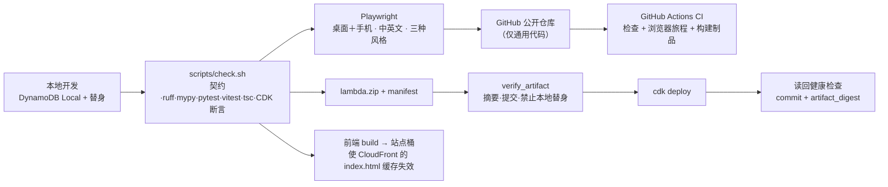

### 10.3 配置与交付

- **可复现构建**：同一提交在不同机器构建得到相同摘要；清单与 CloudFormation 输出、健康检查读回三方一致。
- **私人参数**：账户、域名、告警邮箱放在 `config/private/`（不入库）；部署使用专用 profile。
- **前端发布**：构建后同步到站点桶，并使 CloudFront 的 `index.html` 缓存失效，否则旧页面会残留。
- **生产部署**由账户持有人在自己的终端执行；仅前端变更不需要 `cdk deploy`。
- 详细步骤见 `docs/部署.md`。

## 11. 可观测性与运行维护

- **日志**：结构化日志，保留 14 天；不含账目正文、照片、密码、Prompt 或模型响应。
- **告警**：死信队列有消息、队列积压超过 10 分钟、API 5xx 在 5 分钟内达 5 次、Worker 错误在 15 分钟内达 3 次，均经 SNS 发邮件；AWS Budgets 在 80% 与 100% 发邮件；应用内预算告警经飞书通知系统管理员。
- **费用页**：模型用量估算、未知用量次数、账单同步值（抵扣前用量、抵扣、实付、标签覆盖度、无标签用量按服务拆分）。
- **运维命令**：`ledger.ops` 提供初始化、币种、历史导入、演示数据、密钥、账号邮箱等命令。
- **恢复**：时间点恢复到新表后核对再决定是否切换；回滚为部署上一制品并读回。步骤见 `docs/运维Runbook.md`。

## 12. 架构风险与权衡

| ID       | 决策/风险                         | 备选方案               | 当前结论                                     | 后果/后续行动                                        |
| -------- | --------------------------------- | ---------------------- | -------------------------------------------- | ---------------------------------------------------- |
| ADR-0001 | 技术栈与仓库结构                  | 其他语言与结构         | 已采纳                                       | Python 后端、React 前端、CDK                         |
| ADR-0002 | 每条账目必须挂叶子分类            | 允许挂一级分类         | 已采纳                                       | 统计与导入规则简单                                   |
| ADR-0003 | 小票拆分仅在候选阶段              | 入账后再拆分           | 已采纳                                       | 避免重复计支出                                       |
| ADR-0004 | 供应商汇率全局，家庭补录局部      | 每家庭独立抓取         | 已采纳                                       | 节省请求，补录只影响本家庭                           |
| ADR-0005 | 用户显示名                        | 仅用登录名             | 已采纳                                       | 登录名可改而历史显示稳定                             |
| ADR-0006 | 类型变更、退款关联及其他默认      | —                      | 已采纳                                       | 见 ADR 正文                                          |
| ADR-0007 | 本地开发与生产隔离                | 共用环境               | 已采纳                                       | 生产配置拒绝本地身份                                 |
| ADR-0008 | 动作回执与外部重放保留            | 仅靠重试               | 已采纳                                       | 回执永久保留，无正文                                 |
| ADR-0009 | DynamoDB 单表设计                 | 多表、关系数据库       | 已采纳                                       | 无 Scan，事务有 100 项上限                           |
| ADR-0010 | 总览汇总与分页一致性              | 缓存汇总               | 已采纳                                       | 以月版本检测并发变化                                 |
| ADR-0011 | 模型适配边界与分层结果            | 直接信任模型输出       | 已采纳                                       | 结果分四层记录                                       |
| ADR-0012 | 身份、会话与登录名                | Cognito 别名登录       | 已采纳                                       | 应用解析登录名；邮件交付临时密码                     |
| ADR-0013 | 飞书接入协议与流程                | 群聊、轮询             | 已采纳                                       | 仅私聊；真实联调待完成                               |
| ADR-0014 | 部署形态与权限边界                | 单一函数、单一权限     | 已采纳                                       | 六个入口按权限拆分；冷启动靠内存与预热               |
| ADR-0015 | 识别模型选型与结构化输出          | 更大或更小模型         | 已采纳                                       | Nova Pro；经带标签的推理配置文件归集费用             |

已知限制与后续：

- Worker 写账目的限制只靠代码保证。
- 夜间（新西兰 0–7 点）不预热，首次访问可能等待约 2 秒。
- 英文界面不翻译用户数据；飞书机器人、导出表头、AI 识别出的备注仍为中文。
- MOP 无 ECB 数据源，需家庭手工补录汇率。
- 新建家庭的事务约 85 项；若全局币种继续增加到约 25 种以上，需要把币种启用拆出事务。
- 模型评估使用合成样本，不代表总体生产准确率；Prompt、模型或归一化变更后须重跑评估脚本。
- 删除日志重放与“用恢复表启动隔离环境”两步尚未演练。
- 预算告警需在费用真实达到阈值时才能确认送达。

## 13. 实施顺序与验证点

| 里程碑 | 架构交付物                               | 依赖 | 验证标准                                 | 状态   |
| ------ | ---------------------------------------- | ---- | ---------------------------------------- | ------ |
| M1     | 契约、存储设计、ADR、本地环境            | 无   | 契约校验与本地启动                       | 完成   |
| M2     | 领域规则、账目与家庭接口、前端主流程     | M1   | 契约测试、集成测试、浏览器旅程           | 完成   |
| M3     | AI 识别链路与模型选型                    | M2   | 离线测试；真实模型评估                   | 完成   |
| M4     | 飞书接入                                 | M3   | 离线测试通过；真实联调待完成             | 部分   |
| M5     | 部署、回滚、恢复演练、告警               | M2   | 读回版本；回滚与 PITR 演练               | 完成   |
| M6     | 首发初始化与历史导入                     | M5   | 对账一致                                 | 完成   |
| M7     | 多币种同步、账单同步、中英文、手机端适配 | M5   | 浏览器旅程与生产读回                     | 完成   |

## 14. 架构检查清单

- [x] 每个核心 FR 能在组件与流程中找到承载位置
- [x] 数据流、信任边界和外部依赖已标注
- [x] NFR 有对应架构策略与验证方式
- [x] 密钥、权限、审计与隐私控制已说明
- [x] 失败、重试、幂等和恢复场景已考虑
- [x] 部署、配置、日志与监控方案可执行
- [x] 技术选型有理由，重大风险有记录

## 15. 变更记录

| 版本 | 日期       | 变更                                                                                       | 作者             |
| ---- | ---------- | ------------------------------------------------------------------------------------------ | ---------------- |
| v1.0 | 2026-10-12 | 按标准模板整理本地架构说明；补充组件编号、手机端适配、账单按服务拆分与邮件交付临时密码 | 项目所有者与助手 |
