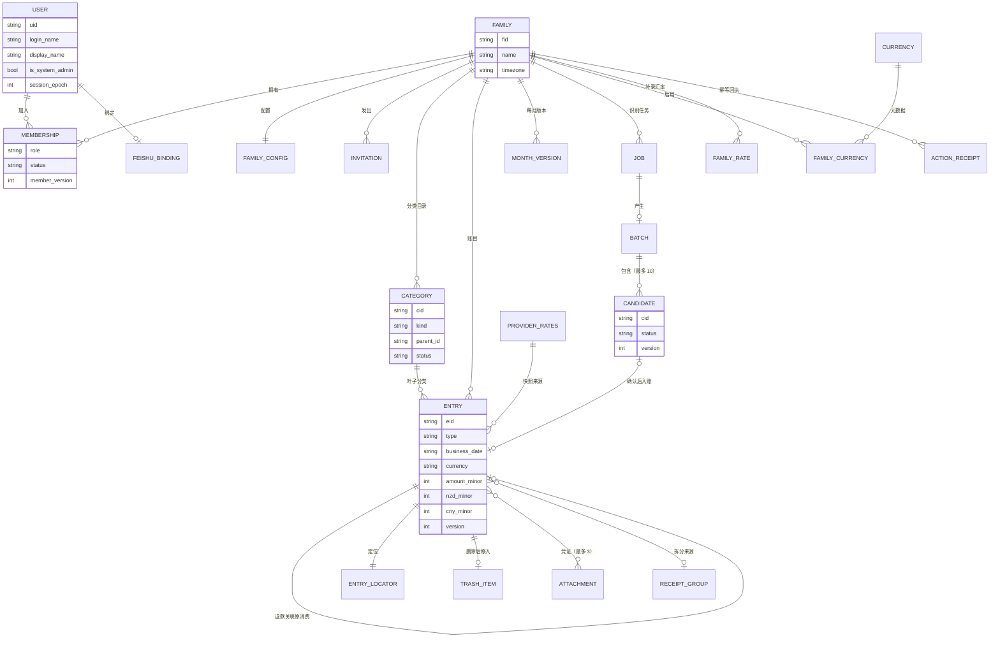

# 数据模型设计文档（Data Model / Database Schema）

## 0. 文档信息

| 项目             | 内容                                                         |
| ---------------- | ------------------------------------------------------------ |
| 项目名称         | 小家账本（family-ledger）                                    |
| 文档版本/状态    | v1.0 / Approved                                              |
| 数据库设计负责人 | 项目所有者（个人项目）                                       |
| 日期             | 2026-10-12                                                   |
| 相关文档         | [PRD](./01-PRD.md) · [Architecture](./03-SYSTEM-ARCHITECTURE.md) · [API](./05-API-SPECIFICATION.md) |

> 本文是业务数据的逻辑与物理结构说明。键设计、访问模式与事务计划的完整推导见 `docs/storage-design.md`（ADR-0009），键构造代码见 `backend/src/ledger/adapters/dynamo/keys.py`；二者与本文冲突时先核对代码，再同步修订。字段的对外形态以 `contracts/openapi.yaml` 为准。

## 1. 数据设计概述

- **存储**：DynamoDB 单表（主表）加一张删除日志表；照片与导出文件在 S3，表中只保存元数据与引用。
- **设计取向**：按访问模式建模，不使用 Scan 计算任何业务结果；同一家庭的数据共用分区键 `FAMILY#<fid>`，用排序键前缀区分实体。
- **一致性**：写入以 DynamoDB 事务保证；每个事务同时检查账号状态、成员版本和乐观锁版本；账目写入同时递增月版本。
- **金额**：原币金额以整数最小单位存储（`amount_minor`），折算值同样为整数（`nzd_minor`、`cny_minor`），汇率为十进制字符串，绝不使用浮点。
- **时间**：创建与修改时间为 UTC ISO-8601（毫秒）；业务日期为家庭时区的日历日期 `YYYY-MM-DD`。

## 2. 业务实体清单（Entity Inventory）

| 实体 ID | 实体名                 | 业务含义                                                         | 对应需求            | 预估数量                 | 数据敏感级别        |
| ------- | ---------------------- | ---------------------------------------------------------------- | ------------------- | ------------------------ | ------------------- |
| ENT-001 | 账号（User）           | 个人账号资料、会话边界、飞书绑定；含系统账号目录与身份映射       | FR-001、FR-002、FR-003、FR-017 | 个位数        | 个人信息（含邮箱）  |
| ENT-002 | 登录名映射与改名操作   | 登录名到用户 ID 的唯一映射；改名操作记录                         | FR-001、FR-003      | 个位数                   | 个人信息            |
| ENT-003 | 家庭（Family）         | 家庭名称与时区                                                   | FR-004              | 个位数                   | 普通                |
| ENT-004 | 家庭配置               | 默认币种、辅助币种、默认消费方式、分类目录版本                   | FR-004              | 每家庭 1                 | 普通                |
| ENT-005 | 成员（Membership）     | 家庭成员与角色；用户侧的家庭镜像                                 | FR-005              | 每家庭个位数             | 个人信息            |
| ENT-006 | 邀请（Invitation）     | 家庭邀请与用户侧镜像                                             | FR-005              | 极少                     | 普通                |
| ENT-007 | 分类（Category）       | 两级分类目录                                                     | FR-013              | 每家庭约数十至百         | 普通                |
| ENT-008 | 账目（Entry）          | 正式账目（收入、支出、退款等）                                   | FR-006 至 FR-012    | 每年数百条               | 敏感（财务）        |
| ENT-009 | 账目定位（EntryLocator）| 按账目 ID 找到其当前位置（正式、回收站、已清除）                | FR-007、FR-009      | 与账目相同               | 普通                |
| ENT-010 | 回收站项（TrashItem）  | 已删除账目，30 天后清除                                          | FR-009              | 少量                     | 敏感（财务）        |
| ENT-011 | 月版本（MonthVersion） | 每家庭每月一个版本计数，用于总览并发检测                         | FR-011              | 每家庭每月 1             | 普通                |
| ENT-012 | 识别任务（Job）        | 一次 AI 识别请求及其状态、租约、用量                             | FR-015、FR-017      | 与 AI 使用量成正比       | 普通                |
| ENT-013 | 批次与候选             | 识别结果批次及候选条目                                           | FR-015、FR-016      | 与 AI 使用量成正比       | 敏感（财务）        |
| ENT-014 | 附件（Attachment）     | 小票照片的元数据与引用计数                                       | FR-010              | 每年数十                 | 敏感                |
| ENT-015 | 动作回执（ActionReceipt）| 幂等重放的结果记录                                             | FR-006、NFR-003     | 与写操作成正比           | 普通                |
| ENT-016 | 全局币种               | 币种元数据（小数位、中文名、是否有数据源）                       | FR-014              | 约 12                    | 普通                |
| ENT-017 | 家庭启用币种           | 家庭可使用的币种                                                 | FR-014              | 每家庭约 12              | 普通                |
| ENT-018 | 供应商汇率组           | 某日的 ECB 汇率（以 USD 为基准）                                 | FR-014              | 每日 1                   | 公开数据            |
| ENT-019 | 家庭汇率修正           | 家庭补录或修正的某日某币种汇率                                   | FR-014              | 极少                     | 普通                |
| ENT-020 | 导出任务               | 导出请求及生成文件位置                                           | FR-012              | 少量，7 天过期           | 敏感                |
| ENT-021 | 飞书身份与绑定码       | 飞书身份到账号的映射；一次性绑定码                               | FR-017              | 个位数                   | 个人信息            |
| ENT-022 | 费用记录               | 模型用量与账单同步值                                             | FR-018              | 每月数十至数百           | 普通                |
| ENT-023 | 预算告警               | 月度阈值告警与去重                                               | FR-018              | 每月至多 2               | 普通                |
| ENT-024 | 小票凭证组             | 一张小票拆分出的多条账目的共同凭证                               | FR-016              | 极少                     | 敏感                |
| ENT-025 | 重算任务               | 显式汇率重算的预览与分片进度                                     | FR-014              | 极少                     | 普通                |
| ENT-026 | 审计（Audit）          | 关键操作审计，180 天                                             | NFR-004             | 与写操作成正比           | 普通（无备注原文）  |
| ENT-027 | 发件箱（Outbox）       | 待派发的外部副作用（识别、飞书卡片、回执、告警）                 | NFR-003             | 与任务成正比             | 普通                |
| ENT-028 | 飞书事件去重           | 事件 ID 去重，30 天                                              | FR-017              | 少量                     | 普通                |
| ENT-029 | 删除日志               | 最小删除标记，防止从备份复活                                     | FR-009、NFR-006     | 与彻底清除次数相同       | 普通                |

## 3. 实体关系图（ER Diagram）

> 图中实体对应的键与字段见第 4 节；账目与定位项、回收站项在存储上是同一分区内的不同排序键。

## 4. 实体定义与字段字典（Schema Dictionary）

### 4.0 通用属性与键约定

所有主表项都有：

| 字段                    | 数据类型 | 可空 | 默认值 | 约束/索引                         | 业务含义                          | 敏感性 |
| ----------------------- | -------- | ---- | ------ | --------------------------------- | --------------------------------- | ------ |
| PK                      | S        | 否   | 无     | 分区键                            | 分区，如 `FAMILY#<fid>`           | 普通   |
| SK                      | S        | 否   | 无     | 排序键                            | 实体前缀加标识                    | 普通   |
| type                    | S        | 否   | 无     | —                                 | 实体名                            | 普通   |
| version                 | N        | 视实体 | 1    | 乐观锁，条件写入                  | 修订号                            | 普通   |
| created_at、updated_at  | S        | 否   | 当前时间 | UTC ISO-8601 毫秒              | 创建与修改时间                    | 普通   |
| GSI1PK、GSI1SK          | S        | 是   | 无     | 稀疏索引 `GSI1`                   | 到期工作（见 QRY-013）            | 普通   |
| ttl                     | N        | 是   | 无     | DynamoDB TTL（epoch 秒）          | 仅用于明确允许自动过期的项        | 普通   |

### 4.1 ENT-001 — 账号

| 键                                   | 说明                                             |
| ------------------------------------ | ------------------------------------------------ |
| `USER#<uid>` / `PROFILE`             | 账号资料                                         |
| `USER#<uid>` / `FAM#<fid>`           | 我所属家庭的镜像（与成员项同事务维护）           |
| `USER#<uid>` / `INVITE#<fid>#<iid>`  | 我收到的邀请镜像（见 ENT-006）                   |
| `USER#<uid>` / `FEISHU`              | 飞书绑定（用户侧）                               |
| `USER#<uid>` / `ACTION#<key>`        | 账号级动作回执（创建家庭、改资料等）             |
| `USERS` / `<uid>`                    | 账号目录，供系统管理员列表，避免 Scan            |
| `SUB#` / `SUB`                  | 身份服务主体到用户 ID 的映射                     |

| 字段                | 数据类型 | 可空 | 约束/说明                                                    | 敏感性   |
| ------------------- | -------- | ---- | ------------------------------------------------------------ | -------- |
| cognito_sub         | S        | 否   | 身份服务主体，唯一                                           | 个人信息 |
| login_name          | S        | 否   | 展示用登录名，唯一性由 ENT-002 保证                          | 个人信息 |
| display_name        | S        | 否   | 显示名（ADR-0005）                                           | 个人信息 |
| email               | S        | 是   | 受邀人邮箱，仅用于身份服务发送临时密码邮件                   | 个人信息 |
| status              | S        | 否   | `active`／`disabled`                                         | 普通     |
| must_change_password| BOOL     | 否   | 首次登录或重置后为真                                         | 普通     |
| is_system_admin     | BOOL     | 否   | 仅保存在应用资料，不使用身份服务的组（ADR-0012）             | 普通     |
| session_epoch       | N        | 否   | 会话边界；改密、重置、停用时递增                             | 普通     |
| sessions_valid_after| S        | 否   | 早于该时刻签发的令牌一律失效                                 | 普通     |

飞书绑定（`FEISHU` 项）：`tenant_key`、`open_id`、`default_family_id`、`binding_epoch`、`status`（`active`／`suspended`）。

### 4.2 ENT-002 — 登录名映射与改名操作

| 键                                   | 字段                                                       |
| ------------------------------------ | ---------------------------------------------------------- |
| `LOGIN#<小写登录名>` / `LOGIN`       | `uid`、`state`（`active`／`reserved`）、`reserved_until`   |
| `USER#<uid>` / `RENAME#<op_id>`      | `old`、`new`、`state`（`pending`／`done`／`failed`）       |

登录名区分大小写的展示形式保存在账号资料；映射键使用小写，保证不区分大小写的唯一性（CON-001）。改名为单个事务（ADR-0012），因此当前实现总是同步完成。

### 4.3 ENT-003 与 ENT-004 — 家庭与家庭配置

| 键                              | 字段                                                                                                              |
| ------------------------------- | ----------------------------------------------------------------------------------------------------------------- |
| `FAMILY#<fid>` / `META`         | `name`、`timezone`（默认 `Pacific/Auckland`）、`admin_count`                                                      |
| `FAMILY#<fid>` / `CONFIG`       | `default_currency`、`secondary_currency`（可空，不得等于默认币种）、`default_payment_method`、`category_manifest_version`、`version` |

`category_manifest_version` 在分类变更时递增，写账目与确认候选的事务以它做条件检查，防止基于过期分类目录入账。

### 4.4 ENT-005 与 ENT-006 — 成员与邀请

| 键                              | 字段                                                                          |
| ------------------------------- | ----------------------------------------------------------------------------- |
| `FAMILY#<fid>` / `MEMBER#<uid>` | `role`（`admin`／`member`）、`status`（`active`／`removed`）、`member_version`、`joined_at`、`removed_at` |
| `FAMILY#<fid>` / `INVITE#<iid>` | `invitee_uid`、`role`、`invited_by`、`expires_at`、`status`（`pending`／`accepted`／`declined`／`revoked`／`expired`） |

### 4.5 ENT-007 — 分类

`FAMILY#<fid>` / `CAT#<cid>`

| 字段        | 数据类型 | 可空 | 约束/说明                                                              |
| ----------- | -------- | ---- | ---------------------------------------------------------------------- |
| kind        | S        | 否   | `expense`、`income`、`internal_transfer`、`exchange`、`card_repayment`、`receivable` |
| parent_id   | S        | 是   | 空表示一级分类；有值表示叶子（二级）分类                               |
| name        | S        | 否   | 展示名（用户数据，不翻译）                                             |
| status      | S        | 否   | `active`／`disabled`；已删除项为软删除                                 |
| redirect_to | S        | 是   | 合并后指向目标叶子分类                                                 |
| sort        | N        | 否   | 同级排序                                                               |
| version     | N        | 否   | 乐观锁                                                                 |

### 4.6 ENT-008 — 账目

`FAMILY#<fid>` / `ENTRY#<YYYY-MM>#<YYYY-MM-DD>#<created_at>#<eid>`。排序键中的月份与日期来自业务日期，使按月查询是排序键前缀查询；跨月修改时删除旧项并写入新项（并更新定位项）。

| 字段                  | 数据类型 | 可空 | 约束/说明                                                                                      | 对应规则        |
| --------------------- | -------- | ---- | ---------------------------------------------------------------------------------------------- | --------------- |
| entry_id              | S        | 否   | 稳定账目 ID，创建后不变                                                                        | —               |
| type                  | S        | 否   | `expense`、`income`、`refund`、`internal_transfer`、`exchange`、`card_repayment`、`receivable` | BR-007          |
| business_date         | S        | 否   | 家庭时区的日历日期                                                                             | BR-005          |
| leaf_category_id      | S        | 否   | 必须是有效叶子分类，且类别与账目类型一致                                                       | BR-001          |
| currency              | S        | 否   | 币种代码，必须是家庭启用币种                                                                   | BR-005          |
| amount_minor          | N        | 否   | 原币金额的整数最小单位，必须为正                                                               | BR-002          |
| nzd_minor、cny_minor  | N        | 否   | 按快照折算并四舍五入后保存的整数分值                                                           | BR-006          |
| fx_snapshot           | M        | 否   | `requested_date`、`effective_date`、`provider`、`rates`（十进制字符串）、`fetched_at`、`manual` | BR-005          |
| payment_method        | S        | 是   | `credit_card`、`debit_card`、`cash`；支出必填                                                  | BR-003          |
| note                  | S        | 是   | 备注，最长 200 字                                                                              | —               |
| created_by            | S        | 否   | 录入人用户 ID（移除成员后仍保留）                                                              | —               |
| source                | S        | 否   | `manual`、`web_ai`、`feishu`、`import`                                                         | —               |
| refund_of             | S        | 是   | 退款指向的原消费账目 ID                                                                        | BR-004          |
| refund_ids            | L        | 是   | 原消费上的关联退款 ID 列表                                                                     | BR-004          |
| refunded_minor        | N        | 是   | 原消费上累计已退款原币金额，不得超过 `amount_minor`                                            | BR-004          |
| receipt_group_id      | S        | 是   | 拆分小票的凭证组                                                                               | BR-015          |
| attachment_ids        | L        | 是   | 最多 3 个附件引用                                                                              | FR-010          |
| version               | N        | 否   | 乐观锁                                                                                         | BR-010          |

### 4.7 ENT-009 与 ENT-010 与 ENT-011 — 定位、回收站、月版本

| 键                                | 字段                                                                                              |
| --------------------------------- | ------------------------------------------------------------------------------------------------- |
| `FAMILY#<fid>` / `ENTRYLOC#<eid>` | `sk`（当前排序项或回收站项的排序键）、`state`（`active`／`trashed`／`purged`）                    |
| `FAMILY#<fid>` / `TRASH#<eid>`    | 删除时整项移入；`deleted_at`、`deleted_by`、`purge_after`；`GSI1` 记录到期                        |
| `FAMILY#<fid>` / `MONTHVER#<YYYY-MM>` | `version` 计数；任何影响该月汇总的写入都会递增                                                |

### 4.8 ENT-012 与 ENT-013 — 识别任务、批次与候选

| 键                                         | 字段                                                                                                                                  |
| ------------------------------------------ | ------------------------------------------------------------------------------------------------------------------------------------- |
| `FAMILY#<fid>` / `JOB#<jid>`               | `actor_uid`、`source`、`business_key`、输入引用、`status`（`received`／`queued`／`running`／`candidate_ready`／`failed`）、`attempt`、`lease_until`、`fencing_token`、`model_calls`（至多 2）、`usage`（已知小计与未知次数）、`error_class`、分层结果 `outcome`、版本绑定（模型、Prompt、Schema、配置） |
| `FAMILY#<fid>` / `BATCH#<bid>`             | `actor_uid`、`source`、`job_id`、`status`（`open`／`closed`／`expired`／`cancelled`）、`expires_at`、`version`                       |
| `FAMILY#<fid>` / `BATCH#<bid>#CAND#<cid>`  | 候选字段、`field_sources`、`missing_fields`、`needs_review`、`version`、`status`（`ready`／`incomplete`／`needs_update`／`confirmed`／`deleted`／`expired`）、`entry_id`、`receipt_group_id`、`fx_preview`、`content_digest` |

`business_key` 对网站来源是“发起人加动作 ID”，对飞书来源是“租户加消息 ID”，用于保证同一输入只产生一个任务。

### 4.9 ENT-014 — 附件

`FAMILY#<fid>` / `ATT#<aid>`

| 字段                          | 数据类型 | 可空 | 约束/说明                                          |
| ----------------------------- | -------- | ---- | -------------------------------------------------- |
| uploader                      | S        | 否   | 上传人用户 ID                                      |
| s3_key、s3_version_id         | S        | 否   | 对象位置与版本                                     |
| sha256、content_type、bytes、pixels | 混合 | 否 | 服务端校验得到的真实属性                           |
| status                        | S        | 否   | `pending`／`ready`／`rejected`                     |
| ref_count、ref_version        | N        | 否   | 被账目或凭证组引用的计数与版本                     |
| orphan_after                  | S        | 是   | 未引用时的清理时间（7 天）                         |

### 4.10 ENT-015 — 动作回执

`FAMILY#<fid>` / `ACTION#<actor_uid>#<key>`：`kind`、`fingerprint`（请求正文摘要）、`status`、`result_ids`、`result_versions`。永久保留，不含正文。账号级动作用 `USER#<uid>` / `ACTION#<key>`。

### 4.11 ENT-016 至 ENT-019 — 币种与汇率

| 实体    | 键                                              | 字段                                                              |
| ------- | ----------------------------------------------- | ----------------------------------------------------------------- |
| ENT-016 | `CURRENCY` / `<CUR>`                            | `minor_digits`、`name_zh`、`provider_supported`                   |
| ENT-017 | `FAMILY#<fid>` / `CUR#<CUR>`                    | `enabled_at`、`enabled_by`                                        |
| ENT-018 | `RATES#ecb` / `<YYYY-MM-DD>`                    | 以 USD 为基准的汇率表、`revision`、`fetched_at`                   |
| ENT-019 | `FAMILY#<fid>` / `RATE#<YYYY-MM-DD>#<CUR>`      | `usd_value`、`revision`、`entered_by`、`reason`                   |

### 4.12 ENT-020 至 ENT-029 — 其余实体

| 实体    | 键                                                                    | 主要字段                                                                                 |
| ------- | --------------------------------------------------------------------- | ---------------------------------------------------------------------------------------- |
| ENT-020 | `FAMILY#<fid>` / `EXPORT#<jid>`                                       | `filter`、`status`（`queued`／`running`／`ready`／`failed`）、`s3_key`、`expires_at`；`ttl` 7 天 |
| ENT-021 | `FSID#<tenant>#<open_id>` / `FSID`；`BINDCODE#<sha256(code)>` / `CODE` | 身份映射：`uid`、`binding_epoch`；绑定码：`uid`、`family_id`、`expires_at`、`used`（`ttl` 为到期加一天） |
| ENT-022 | `COST#<YYYY-MM>` / `USAGE#<ts>#<id>`、`BILL#<date>`                   | 模型 tokens 与未知标记；账单同步值（抵扣前用量、抵扣、覆盖度、无标签用量按服务拆分）      |
| ENT-023 | `COST#<YYYY-MM>` / `ALERT#<threshold>`                                | `basis`、`triggered_at`、`delivery`；条件写入保证同月同阈值只一条                        |
| ENT-024 | `FAMILY#<fid>` / `RGROUP#<gid>`                                       | `currency`、`total_minor`、`attachment_id`、`child_entry_ids`                            |
| ENT-025 | `FAMILY#<fid>` / `RECOMPUTE#<jid>`                                    | `scope`、`preview_digest`、`status`（`preparing`／`preview_ready`／`applying`／`done`／`failed`／`superseded`）、`progress_cursor`、`done_count` |
| ENT-026 | `FAMILY#<fid>` / `AUDIT#<ts>#<id>`                                    | `actor`、`action`、对象、前后结构值（只含 ID、版本、字段名与金额分类等，不含备注原文）；`ttl` 180 天 |
| ENT-027 | `FAMILY#<fid>` / `OUTBOX#<id>`                                        | `kind`（`recognize`／`feishu_card`／`feishu_receipt`／`alert`）、载荷引用、`status`（`pending`／`sent`／`failed`／`unknown`）、`attempts`、`next_attempt_at` |
| ENT-028 | `FSEVT#<event_id>` / `EVT`                                            | 去重标记；`ttl` 30 天                                                                    |
| ENT-029 | 删除日志表：`entry_id`、`family_id`、`purged_at`、附件版本 ID         | 恢复环境开放流量前先重放                                                                 |

## 5. 字段级标准与约定

| 类别 | 规范/决策                                                                                              |
| ---- | ------------------------------------------------------------------------------------------------------ |
| 主键 | 字符串 ID，由应用在写入前生成（不依赖数据库自增）；分区键前缀表示命名空间                              |
| 命名 | 属性用 snake_case；键前缀用大写加 `#` 分隔                                                             |
| 金额 | 原币金额与折算值都是整数最小单位；币种小数位来自币种元数据；汇率是十进制字符串，不提前截断             |
| 时间 | 创建与修改时间存 UTC；业务日期存家庭时区的日历日期；排序键中的时间戳为固定宽度的毫秒                   |
| 枚举 | 见各实体说明；新增枚举值须同步 OpenAPI 契约与前端标签                                                  |
| 空值 | 可空字段缺失即表示“未设置”；金额无证据时候选留空而不是 0                                               |
| 删除 | 账目为回收站加 30 天清除；分类为软删除加重定向；邀请与候选到期失效；彻底清除前先写删除日志             |
| 审计 | 关键写操作写审计项；审计与回执不保存备注原文                                                           |
| 文件 | 照片与导出在 S3，表中保存键、版本与摘要；照片桶开启版本控制                                            |

## 6. 主键、外键、唯一性与完整性约束

DynamoDB 没有外键，下列约束都由条件表达式或事务内的条件检查保证。

| 约束 ID | 实体            | 类型       | 约束                                                                                           | 对应业务规则 |
| ------- | --------------- | ---------- | ---------------------------------------------------------------------------------------------- | ------------ |
| CON-001 | ENT-002         | UNIQUE     | 登录名映射项条件写入（不存在才创建），保证不区分大小写唯一                                     | BR-016       |
| CON-002 | ENT-003、ENT-005| 完整性     | 降级或移除管理员的事务条件：`admin_count` 大于 1                                               | BR-012       |
| CON-003 | ENT-008、ENT-007| 引用       | 写账目的事务检查分类目录版本与叶子分类有效、类别一致                                           | BR-001       |
| CON-004 | ENT-008         | 业务约束   | 退款事务内条件：原消费有效、币种相同、已退款加本次不超过原金额                                 | BR-004       |
| CON-005 | ENT-015         | UNIQUE     | 动作回执条件写入（不存在才创建），与业务数据同事务                                             | NFR-003      |
| CON-006 | 各实体          | 乐观锁     | 修改、删除、确认以 `version` 等于读取值为条件                                                  | BR-010       |
| CON-007 | ENT-012         | 租约       | 发布候选须 `fencing_token` 与租约仍有效，旧 Worker 无法发布                                    | BR-009       |
| CON-008 | ENT-013         | 版本绑定   | 确认候选须 `version` 与展示版本一致、状态为 `ready`、汇率版本绑定                              | BR-009       |
| CON-009 | ENT-001、ENT-005| 授权       | 每个事务含账号状态与会话边界检查、成员状态与版本检查                                           | BR-011       |
| CON-010 | ENT-028、ENT-012| UNIQUE     | 飞书事件去重项与按消息 ID 派生的任务条件写入                                                   | NFR-003      |
| CON-011 | ENT-014         | 引用计数   | 账目关联附件时 `ref_count` 递增并置为 `ready`                                                  | FR-010       |
| CON-012 | ENT-004         | 业务约束   | 辅助币种不得等于默认币种（应用层校验）                                                         | FR-004       |
| CON-013 | ENT-023         | UNIQUE     | 告警项条件写入，同月同阈值只一条                                                               | BR-014       |

## 7. 查询模式与索引设计

| 查询 ID | 使用场景/API                     | 过滤/排序字段                                            | 索引建议                              | 预计数据量   | 验证方法           |
| ------- | -------------------------------- | -------------------------------------------------------- | ------------------------------------- | ------------ | ------------------ |
| QRY-001 | 登录名到用户 / API-001           | `LOGIN#<名>` 点查                                        | 主键                                  | 1 项         | 集成测试           |
| QRY-002 | 令牌主体到用户与状态 / 全部接口  | `SUB#` 点查再取 `PROFILE`                                | 主键                                  | 2 项         | 集成测试           |
| QRY-003 | 我的家庭列表 / API-021           | `USER#<uid>` 前缀 `FAM#`                                 | 主键                                  | 个位数       | 集成测试           |
| QRY-004 | 授权检查 / 全部家庭接口          | `FAMILY#<fid>` 点查 `MEMBER#<uid>`                       | 主键，强一致                          | 1 项         | 授权测试           |
| QRY-005 | 月总览与月清单 / API-036、API-037| `FAMILY#<fid>` 前缀 `ENTRY#<月>#`，倒序，分页            | 主键，强一致                          | 每月数十至数百项 | 集成与契约测试 |
| QRY-006 | 按 ID 取账目 / API-040           | 点查 `ENTRYLOC#` 再点查其 `sk`                           | 主键                                  | 2 项         | 集成测试           |
| QRY-007 | 回收站 / API-044                 | 前缀 `TRASH#`                                            | 主键                                  | 少量         | 集成测试           |
| QRY-008 | 分类目录 / API-048               | 前缀 `CAT#`                                              | 主键                                  | 数十至百项   | 集成测试           |
| QRY-009 | 候选批次 / API-069               | 前缀 `BATCH#<bid>`                                       | 主键                                  | 至多 11 项   | 集成测试           |
| QRY-010 | 动作回执查询 / API-047           | 点查 `ACTION#<actor>#<key>`，强一致                      | 主键                                  | 1 项         | 集成测试           |
| QRY-011 | 汇率解析 / API-057               | 家庭修正与全局汇率组，业务日期向前至多 8 天点查          | 主键                                  | 至多 32 次点查 | 集成测试         |
| QRY-012 | 成员与邀请 / API-027、API-030    | 前缀 `MEMBER#`、`INVITE#`                                | 主键                                  | 个位数       | 集成测试           |
| QRY-013 | 到期工作（维护与派发）           | `GSI1PK = WORK#<kind>#<shard 0-3>`，`GSI1SK` 不晚于现在  | `GSI1`（稀疏），处理完成即移除属性    | 少量         | 维护任务测试       |
| QRY-014 | 飞书身份到用户 / API-075         | 点查 `FSID#`                                             | 主键                                  | 1 项         | 集成测试           |
| QRY-015 | 费用月汇总与告警去重 / API-018   | `COST#<月>` 查询；条件写入 `ALERT#`                      | 主键                                  | 数十至数百项 | 集成测试           |
| QRY-016 | 照片引用 / API-065               | 点查 `ATT#`                                              | 主键                                  | 1 项         | 集成测试           |
| QRY-017 | 汇率重算范围 / API-060           | 按月份范围重复 QRY-005                                   | 主键                                  | 与范围成正比 | 集成测试           |

不使用 Scan 计算任何业务结果；维护任务只扫 `GSI1` 分片。`GSI1` 为最终一致，处理前对权威项做强一致读并以条件写入完成。

## 8. 生命周期与状态模型

### 8.1 状态定义

| 对象     | 状态                                                                 | 允许转移                                                                                                                  | 触发条件                       | 不合法转移处理                 |
| -------- | -------------------------------------------------------------------- | ------------------------------------------------------------------------------------------------------------------------- | ------------------------------ | ------------------------------ |
| 账目     | `active` → `trashed` → `purged`（定位项状态）                        | `active → trashed`（删除）；`trashed → active`（30 天内恢复）；`trashed → purged`（30 天后清除）                          | 用户删除、恢复；维护任务       | 已清除返回 `purged`，不可恢复  |
| 识别任务 | `received`、`queued`、`running`、`candidate_ready`、`failed`         | `received → queued → running → candidate_ready`；失败进入 `failed`；租约过期可被接管（重新 `running`）                    | 派发、认领、发布               | 旧租约的发布被条件写入拒绝     |
| 批次     | `open`、`closed`、`expired`、`cancelled`                             | `open → closed`（全部处理）；`open → expired`（7 天）；`open → cancelled`                                                 | 确认、取消、到期               | 非 `open` 的确认被拒绝         |
| 候选     | `ready`、`incomplete`、`needs_update`、`confirmed`、`deleted`、`expired` | `incomplete → ready`（补全）；`ready → needs_update`（分类或汇率变化）；`ready → confirmed`、`deleted`、`expired`    | 编辑、确认、删除、到期         | 版本不符返回候选过期或已变化   |
| 邀请     | `pending`、`accepted`、`declined`、`revoked`、`expired`              | `pending →` 其余四种                                                                                                      | 接受、拒绝、撤销、7 天到期     | 非 `pending` 的接受被拒绝      |
| 成员     | `active`、`removed`                                                  | `active → removed`                                                                                                        | 管理员移除                     | 最后一名管理员不可移除         |
| 附件     | `pending`、`ready`、`rejected`                                       | `pending → ready`（校验通过且被引用）；`pending → rejected`                                                               | 登记完成                       | 未就绪的附件不能关联           |
| 发件箱   | `pending`、`sent`、`failed`、`unknown`                               | `pending → sent`、`failed`、`unknown`；`unknown` 沿同一 uuid 重试                                                         | 派发                           | 超出去重窗口不再自动重发       |
| 导出     | `queued`、`running`、`ready`、`failed`                               | 顺序前进                                                                                                                  | 生成                           | —                              |
| 重算任务 | `preparing`、`preview_ready`、`applying`、`done`、`failed`、`superseded` | `preparing → preview_ready → applying → done`；条件变化时 `superseded`                                                | 预览、确认、分片执行           | 预览与现状不符时拒绝确认       |
| 账号     | `active`、`disabled`                                                 | 双向                                                                                                                      | 系统管理员                     | —                              |
| 飞书绑定 | `unbound`、`active`、`suspended`                                     | `unbound → active`（绑定）；`active → suspended`（改密或重置）；`suspended → active`（重新验证）；`active → unbound`（解绑）| 用户与系统管理员               | —                              |

### 8.2 数据创建、修改、删除

- **创建**：手工记账为单个事务，同时写入账目、定位项、月版本、审计与动作回执；AI 确认最多 10 条，一个事务内全部提交（项数上限计算见 `docs/storage-design.md` 第 4 节）。
- **修改**：同月修改更新原项；跨月修改删除旧项并写入新项、更新定位项与两个月的月版本。改日期或币种取新快照，其余保留原快照。
- **删除**：账目整项移入回收站；有关联退款时须选择一并删除，每笔退款再各移一次。
- **清除**：30 天后先写删除日志，再删除业务项与照片版本。
- **过期**：候选 7 天、邀请 7 天、孤立照片 7 天、导出 7 天、审计 180 天、事件去重 30 天。

## 9. 数据安全、隐私与权限

- **敏感级别**：账目、照片、候选、导出为敏感财务数据；账号资料含邮箱，为个人信息；其余为普通数据。
- **访问控制**：应用代码按成员关系授权；跨家庭一律返回不存在；系统管理员不默认拥有家庭账目读取权；每个事务内重新校验账号与成员状态。
- **函数级权限**：按入口拆分函数，只有 Worker 能调用模型，只有 Maintenance 能删除照片版本与读账单，只有 AuthAdmin 持有身份服务管理权限；DynamoDB 权限无法按排序键前缀限制，Worker 不写账目只由代码约束。
- **加密与密钥**：存储全部私有；密钥在加密参数存储；不在日志、审计与回执中保存备注原文、照片、密码或 Prompt。
- **留存与删除**：见 8.2 与 PRD 第 8 节；清除前写删除日志，防止从备份复活。

## 10. 事务、一致性与并发控制

事务项数均低于 DynamoDB 的 100 项上限。下表为概要，逐项事务清单见 `docs/storage-design.md` 第 4 节。

| 业务操作           | 原子边界                                                        | 并发风险                       | 控制措施                                         | 失败策略                           |
| ------------------ | --------------------------------------------------------------- | ------------------------------ | ------------------------------------------------ | ---------------------------------- |
| 手工创建账目       | 账目、定位、月版本、审计、回执、附件引用（约 11 项）            | 重复请求；分类目录刚被修改     | 动作回执（CON-005）；分类目录版本检查（CON-003） | 条件失败则整体回滚，返回原结果或冲突 |
| 修改账目           | 同月 14 项，跨月 17 项                                          | 两人同时编辑；退款额度变化     | 版本条件（CON-006）；退款重算条件（CON-004）     | 返回当前版本供用户重试             |
| 创建退款           | 原消费额度更新、退款账目、定位、回执、审计、月版本              | 并发退款超额                   | 额度条件（CON-004）                              | 拒绝并提示剩余额度                 |
| 删除与恢复         | 账目移入或移出回收站、定位、月版本、回执、审计                  | 与修改并发                     | 版本条件；恢复时检查原消费与额度                 | 条件失败回滚                       |
| 批次确认（最多 10）| 批次、候选、账目、定位、凭证组、附件、月版本、回执、审计        | 候选被改；重复点击；撤权       | 候选版本绑定（CON-008）；成员条件（CON-009）     | 全部提交或全部不提交               |
| 成员与角色变更     | 成员项、用户镜像、`admin_count`、回执、审计                     | 同时降级两名管理员             | 管理员计数条件（CON-002）                        | 拒绝                               |
| 发布候选           | 批次、候选、任务状态、发件箱                                    | 旧 Worker 迟到                 | 租约与 fencing（CON-007）；发起人仍有效          | 条件失败丢弃旧结果                 |
| 飞书事件接收       | 事件去重、任务、发件箱（3 项）                                  | 平台重复投递                   | 去重与派生任务条件写入（CON-010）                | 重复事件无副作用                   |
| 汇率重算（每分片） | 重算任务进度、至多 20 条账目、月版本、审计                      | 重算期间账目被改               | 账目版本与预览一致；进度游标条件                 | 沿同一任务继续                     |

外部服务（S3、身份服务、飞书、模型）不进入事务：先写 `pending` 状态再执行外部动作，再条件回写；失败沿同一操作 ID 重试。外部副作用只经发件箱，交付状态（`pending`、`sent`、`failed`、`unknown`）与入账状态分开记录。

## 11. Schema 迁移与演进

- DynamoDB 无模式，演进靠“向后兼容读取，新字段可缺省”：新增属性允许缺失，读取代码提供默认值。
- 键设计变更视为破坏性变更，需要数据迁移任务与双写期，并先在 PITR 恢复出的副本上演练。
- 新增枚举值须同步契约与前端标签，并在契约测试中覆盖。
- 全局币种增加会增加“新建家庭”事务项数（当前约 85 项）；超过约 25 种全局币种时需把币种启用拆出事务。
- 种子数据（初始分类模板、币种元数据）在 `seed/`，初始化命令是幂等的。

## 12. 数据备份与恢复

| 项目           | 方案                                                                                     |
| -------------- | ---------------------------------------------------------------------------------------- |
| 备份范围       | 主表与删除日志表（时间点恢复）；照片桶（版本控制）；配置与密钥在代码与参数存储，不在表内 |
| 频率与保留     | 时间点恢复持续，保留 35 天；照片非当前版本 35 天；导出 7 天                               |
| 加密与访问控制 | 云服务默认加密；存储私有；恢复只在账户持有人的受控环境执行                               |
| RPO / RTO      | 数据丢失窗口取决于时间点恢复（接近实时）；上次演练恢复主表耗时 3 分 39 秒                |
| 恢复流程       | 恢复到新表，逐项核对，再决定是否切换；开放流量前先重放删除日志（`docs/运维Runbook.md`）  |
| 演练频率       | 已于 2026-10-04 演练一次（101 项逐项一致）；重大数据结构变更后补测                       |

## 13. 示例数据与测试数据

- 测试只使用合成数据；演示数据生成器（`ledger.ops.demo_data`、`demo_en`）可生成虚构家庭的中文与英文账目。
- 浏览器旅程在独立的本地表上运行，每次运行重建测试管理员，不触及生产。
- 真实账号、账目、照片与历史 Excel 不进入仓库，只保存在私有目录。

## 14. 与需求及接口的映射

| 数据实体/字段              | FR/BR                  | API                            | 备注                                   |
| -------------------------- | ---------------------- | ------------------------------ | -------------------------------------- |
| ENT-001 账号               | FR-001、FR-002、FR-003 | API-001、API-005、API-011      | 会话边界字段决定令牌是否有效           |
| ENT-004 家庭配置           | FR-004、BR-005         | API-025、API-026               | 默认币种与辅助币种决定总览显示         |
| ENT-005 成员               | FR-005、BR-011、BR-012 | API-027 至 API-029             | 管理员计数条件保证至少一名管理员       |
| ENT-007 分类               | FR-013、BR-001         | API-048 至 API-052             | 合并以重定向实现                       |
| ENT-008 账目               | FR-006 至 FR-012       | API-036 至 API-043             | 金额字段为整数最小单位                 |
| ENT-010 回收站项           | FR-009、BR-008         | API-042、API-043、API-044      | 30 天后清除                            |
| ENT-012、ENT-013 任务与候选| FR-015、FR-016、BR-009 | API-066 至 API-074             | 候选版本与汇率版本绑定                 |
| ENT-014 附件               | FR-010                 | API-063 至 API-065             | 引用计数                               |
| ENT-016 至 ENT-019 币种汇率| FR-014、BR-005         | API-053 至 API-062             | 家庭修正只影响本家庭                   |
| ENT-020 导出任务           | FR-012                 | API-045、API-046               | 7 天过期                               |
| ENT-021 飞书身份           | FR-017                 | API-015 至 API-017、API-075    | 以平台可信字段为准                     |
| ENT-022、ENT-023 费用与告警| FR-018、BR-014         | API-018、API-019               | 同月同阈值去重                         |

## 15. 数据设计检查清单

- [x] 每个核心业务对象都有实体、字段与约束
- [x] 完整性约束在数据库或事务条件中得到执行
- [x] 查询模式、排序键与索引有依据
- [x] 金额、时间、枚举、删除等规则明确
- [x] 事务边界与并发冲突已设计
- [x] 敏感数据与权限、留存规则已说明
- [x] 备份与恢复方案已验证一次
- [x] 与 PRD、API 的编号一致

## 16. 修订记录

| 版本 | 日期       | 修改摘要                                                                               | 修改人           |
| ---- | ---------- | -------------------------------------------------------------------------------------- | ---------------- |
| v1.0 | 2026-10-12 | 按标准模板整理：实体编号、字段字典、约束与查询编号、状态模型；纳入邮箱字段与辅助币种 | 项目所有者与助手 |
